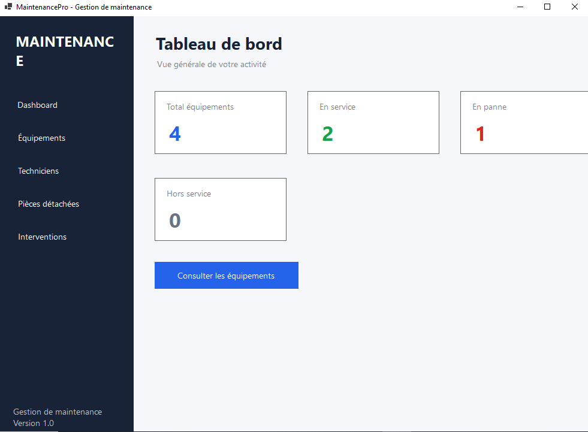
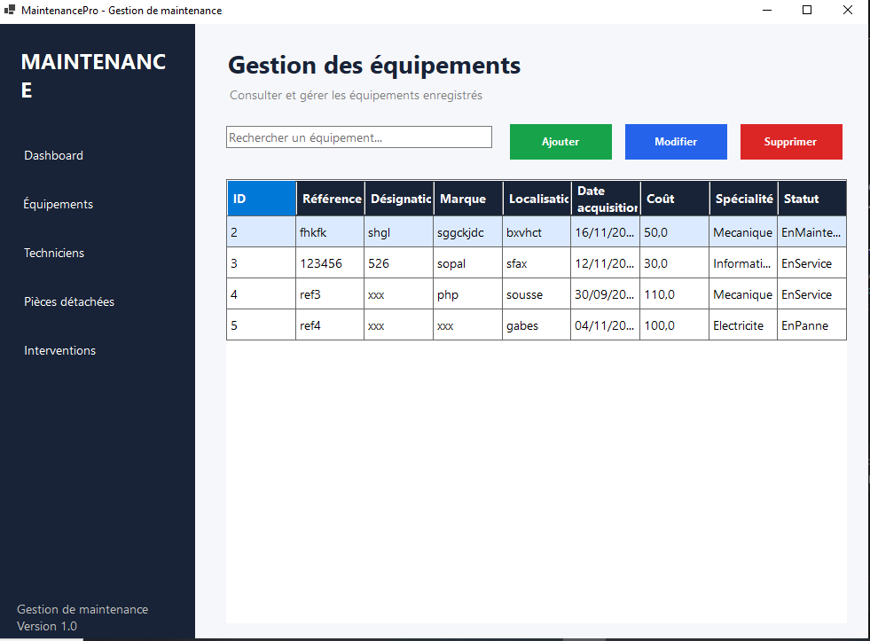
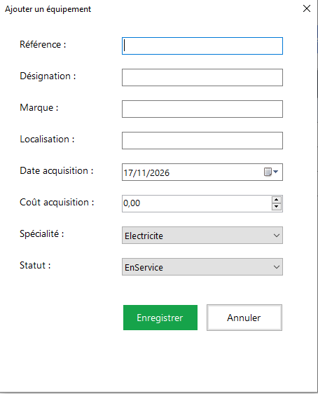
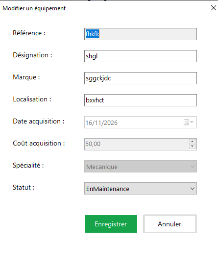
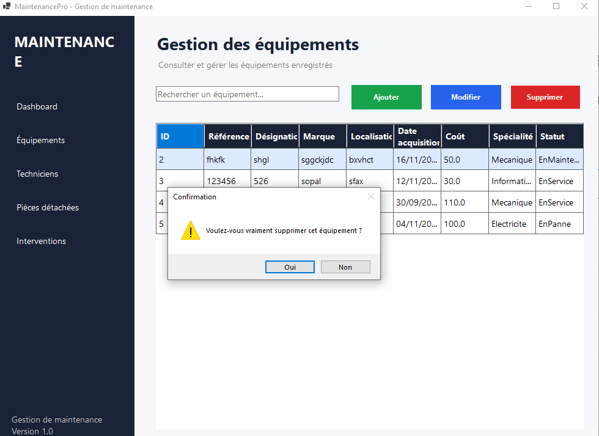

# 🛠️ Gestion des Équipements et Maintenance

Application de bureau développée en *C# et .NET*, avec une base de données *SQLite*, permettant de gérer les équipements et de faciliter le suivi des opérations de maintenance.

Ce projet a pour objectif de centraliser les informations relatives aux équipements, de simplifier leur gestion et de structurer le suivi des interventions de maintenance.

---

## 📌 Présentation du projet

La gestion des équipements représente un enjeu important pour les entreprises et les organisations qui souhaitent assurer le bon fonctionnement de leur matériel.

Cette application propose une solution informatique permettant de gérer les informations des équipements à travers une interface graphique Windows Forms et de stocker les données dans une base SQLite.

Le projet repose sur une architecture organisée en plusieurs couches afin de séparer les responsabilités et de faciliter la maintenance et l'évolution du code.

## 🎯 Objectifs

- Centraliser les informations relatives aux équipements.
- Faciliter l'ajout, la consultation, la modification et la suppression des équipements.
- Organiser les informations liées à la maintenance.
- Structurer le code selon une architecture modulaire.
- Assurer la persistance des données avec SQLite.
- Proposer une interface graphique simple et accessible.

## ✨ Fonctionnalités

### Gestion des équipements
- Affichage de la liste des équipements.
- Ajout d'un nouvel équipement.
- Modification des informations d'un équipement.
- Suppression d'un équipement.
- Consultation des informations telles que la référence, la désignation, la marque et la localisation.

### Gestion de la maintenance
- Organisation des informations relatives aux interventions.
- Structuration des données de maintenance.
- Suivi des informations associées aux équipements.

### Gestion des données
- Stockage des données dans une base SQLite.
- Organisation des accès aux données à travers des repositories.
- Séparation des règles métier et de la couche de persistance.

Remarque : les fonctionnalités peuvent évoluer selon l'état d'implémentation des différents modules.

## 📸 Captures d'écran

### 1. Interface principale

### 2. Gestion des équipements

### 3. Ajout d'un équipement

### 4. Modification d'un équipement

### 5. Suppression d'un équipement

## 🧰 Technologies utilisées

| Technologie | Utilisation |
|---|---|
| C# | Langage de programmation |
| .NET | Plateforme de développement |
| Windows Forms | Création de l'interface graphique |
| SQLite | Système de gestion de base de données |
| Entity Framework Core | Accès et manipulation des données |
| LINQ | Requêtes et manipulation des collections |
| Git | Gestion des versions |
| GitHub | Hébergement du code source |

## 🏗️ Architecture du projet

Le projet est organisé en plusieurs dossiers afin de garantir une meilleure séparation des responsabilités.

text
gestion-equipements-maintenance/
│
├── Data/
│   └── Gestion de la base de données
│
├── Enums/
│   └── Énumérations
│
├── Exceptions/
│   └── Gestion des exceptions personnalisées
│
├── GestionMaintenance.UI/
│   ├── Form1.cs
│   ├── Form1.Designer.cs
│   ├── FormEquipement.cs
│   ├── Program.cs
│   └── GestionMaintenance.UI.csproj
│
├── Migrations/
│   └── Migrations de la base de données
│
├── Models/
│   └── Classes représentant les entités métier
│
├── Repositories/
│   └── Accès et manipulation des données
│
├── Services/
│   └── Logique métier et traitements
│
├── screenshots/
│   └── Captures d'écran de l'application
│
├── GestionMaintenance.csproj
├── Program.cs
├── gestion-maintenance.db
├── README.md
└── .gitignore

### Description des principales couches

- *Models :* contient les classes représentant les objets métier de l'application.
- *Data :* regroupe les éléments nécessaires à la configuration et à l'accès à la base de données.
- *Repositories :* centralise les opérations d'accès aux données.
- *Services :* contient les traitements et les règles métier.
- *Enums :* définit les valeurs énumérées utilisées dans l'application.
- *Exceptions :* regroupe les exceptions personnalisées.
- *Migrations :* conserve l'historique des évolutions du schéma de la base de données.
- *GestionMaintenance.UI :* contient l'interface graphique Windows Forms.

## 🗄️ Base de données

L'application utilise *SQLite*, un système de gestion de base de données relationnelle léger qui ne nécessite pas de serveur de base de données indépendant.

Le fichier de base de données utilisé dans le projet est :

text
gestion-maintenance.db

Les données sont stockées localement afin de permettre leur consultation et leur manipulation par l'application.

## ⚙️ Installation et exécution

### Prérequis

Avant de commencer, assurez-vous de disposer des éléments suivants :

- Windows 10 ou Windows 11.
- .NET SDK compatible avec le projet.
- Git.
- Un environnement de développement comme Visual Studio ou Visual Studio Code.

### 1. Cloner le dépôt

Ouvrir un terminal et exécuter :

git clone https://github.com/raniaberrajah-lab/gestion-equipements-maintenance.git

### 2. Accéder au dossier du projet

cd gestion-equipements-maintenance

### 3. Restaurer les dépendances

dotnet restore GestionMaintenance.UI/GestionMaintenance.UI.csproj

### 4. Compiler le projet

dotnet build GestionMaintenance.UI/GestionMaintenance.UI.csproj

### 5. Lancer l'application

dotnet run --project GestionMaintenance.UI/GestionMaintenance.UI.csproj

*Remarque :* l'exécution nécessite un environnement Windows compatible avec Windows Forms.

## 🔄 Gestion des versions

Le projet utilise Git pour le suivi des modifications et GitHub pour l'hébergement du code source.

Quelques commandes utiles :

git status
git add .
git commit -m "Description des modifications"
git push

## 🚀 Améliorations envisagées

Plusieurs évolutions peuvent être envisagées pour enrichir l'application :

- Ajouter un système d'authentification.
- Améliorer la recherche et le filtrage des équipements.
- Développer un tableau de bord statistique.
- Ajouter des notifications pour les opérations de maintenance.
- Améliorer le suivi de l'historique des interventions.
- Mettre en place une gestion avancée des utilisateurs et des rôles.
- Améliorer l'ergonomie et le design de l'interface.

## 👨‍💻 Auteur

*Mouhamed Fraj* *Rania berrajah*  *tasnim chihaoui*

- GitHub : [@mohamedfraj2004](https://github.com/mohamedfraj2004)
 

## 📄 Licence

Ce projet est réalisé dans un cadre académique et pédagogique.

Toute utilisation, modification ou redistribution doit respecter les conditions applicables au projet et à ses éventuelles dépendances.

---

  <strong>Gestion des Équipements et Maintenance</strong> 
  Développé avec C# • .NET • SQLite

